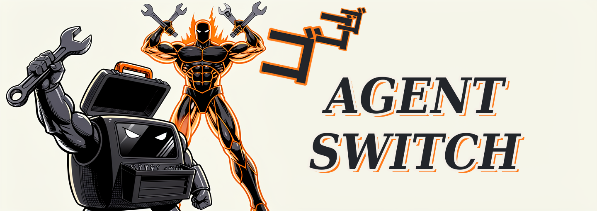
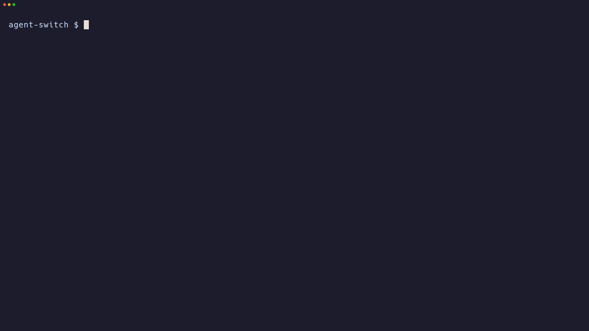

# agent-switch



**Run Claude Code, Codex, OpenCode, Pi, or DeepSeek Harness on your own model server
with one command. Your usual agent settings stay unchanged.**



| Feature | How it works | Example |
|---|---|---|
| **One command per agent** | Name the agent and your model server's address. The agent starts already connected, and agent-switch works out what kind of server it is. | `agent-switch opencode --url http://127.0.0.1:8080` |
| **Several OpenAI-compatible servers at once** | Connect more than one model server in the same command. Give each a short name, and the agent shows all their models in one list. | `agent-switch opencode --url a:http://127.0.0.1:8080 --url b:http://127.0.0.1:11434` |
| **One MCP setup for every agent** | Add tools (MCP servers) the same way for every agent. Save them once in `~/.agent-switch/mcp.json`, and agent-switch turns them into each agent's own format. | `agent-switch claude --mcp context7` and `agent-switch codex --mcp context7` |
| **Session skills** | Add skill folders for one agent session, without changing its saved skill list. | `agent-switch claude --skill /tmp/skills/my-test-skill` |
| **Keys for several providers, no agent login** | Give each server its own key. agent-switch remembers it, never sends it to another server, and hands it to the agent, so you skip the agent's own login. | `agent-switch opencode --url a:http://127.0.0.1:8080 --url b:https://api.example.com/v1 --api-key b:$B_KEY` |
| **Your own servers** | Works with the model servers people usually run: Ollama, LM Studio, llama-server, vLLM, and other OpenAI-compatible servers. | `agent-switch codex --provider ollama` |
| **Your setup stays as it is** | Leave out `--url` and `--provider`, and the agent runs as usual, with its own model, account, and settings. | `agent-switch claude` |
| **Keep your main model** | The agent keeps its usual model and gets a local model as a helper it can hand work to. | `agent-switch claude --url http://127.0.0.1:8080 --as-subagent` |
| **Agents** | Claude Code, Codex, OpenCode, Pi, and DeepSeek Harness (`dsh`, `dsh-tui`, or `dst`). | `agent-switch pi --provider lmstudio` |

## Install

### From source

With uv installed, run this from the repository root:

```sh
uv tool install .
```

Developing agent-switch? Use `uv tool install -e .` so code edits apply on the next run.
Reinstall after changing dependencies. [Installation details](docs/reference.md#installation-details).

### AppImage (Linux)

Download an AppImage from [Releases](https://github.com/scott1028/agent-switch/releases):
`x86_64` for Intel/AMD, or `aarch64` for ARM. It includes Python; uv is not needed.
Rename the download to `agent-switch.AppImage`, then install it:

```sh
install -Dm755 agent-switch.AppImage ~/.local/bin/agent-switch
```

Without FUSE, prefix commands with `APPIMAGE_EXTRACT_AND_RUN=1`.
[AppImage details](docs/reference.md#appimage-linux).

## Start with a local model

Start your model server first. agent-switch connects to it; it does not start the server.

```sh
# Give the server's address
agent-switch claude --url http://127.0.0.1:8080

# Or use a provider's default address
agent-switch codex --provider ollama
agent-switch opencode --provider lmstudio -m qwen/qwen3-8b
```

`--url` detects the provider automatically. For a generic server, use
`--provider openai --url <address>`.
[Using Strata](docs/reference.md#quickstart-strata).

To use an agent's own model, account, and settings, leave out `--url` and `--provider`:

```sh
agent-switch claude
agent-switch codex
```

## Common options

Use these with `--url` or `--provider`:

| Option | What it does |
|---|---|
| `-m MODEL` | Choose the model. |
| `--context-length N` | Set the conversation size in tokens. Use `-1` for the server's full limit. |
| `--max-tokens N` | Limit the length of each reply. |
| `--reasoning on\|off` | Turn the model's reasoning mode on or off. |
| `--reasoning-effort LEVEL` | Choose a thinking level the model supports. |
| `--api-key KEY` | Send an API key and save it for that server. |
| `--no-model-load` | Use an already loaded model without loading or unloading models. |
| `--no-launch` | Print the command instead of starting the agent. |
| `--persist` | Keep the session files so the agent can resume later. |
| `--as-subagent` | Keep the agent's own model and add a local model as a helper. |

`--as-subagent` supports Claude Code, Codex, OpenCode, and Pi. It cannot be combined with MCP flags.
`--yolo` lets the agent approve actions automatically. It also works without a local server.
Pass the agent's own arguments after `--`:

```sh
agent-switch claude -- -p "Explain this project"
agent-switch codex -- exec "Fix the failing test"
```

For all options, run `agent-switch <agent> --help`.
See [context, compaction, and sampling](docs/reference.md#context-and-compaction) for model tuning.

## Use several model servers

Repeat `--url` and give each server a name:

```sh
agent-switch opencode \
  --url a:http://127.0.0.1:8080 \
  --url b:http://127.0.0.1:11434 \
  --model b:qwen3:8b
```

The agent sees models from both servers. `b:qwen3:8b` means “use `qwen3:8b` from server `b`.”
[Multiple-server options and limits](docs/reference.md#multiple-servers).

## Add tools with MCP

MCP servers give your agent extra tools. Add a running server by URL, or start one with a command:

```sh
agent-switch claude --mcp-url http://127.0.0.1:8931/mcp
agent-switch claude --mcp-stdio 'uv run --directory /opt/blender-mcp blender-mcp'
```

Or save servers in `~/.agent-switch/mcp.json` and select them by name:

```sh
agent-switch claude --mcp context7 --mcp github
agent-switch codex --mcp-all
```

Without a local model server, these tools are added to the agent's existing tools.
With `--url` or `--provider`, the selected MCP servers replace the agent's own MCP servers
for that session. [Registry format, authentication, and examples](docs/reference.md#mcp-servers).

## Add a skill for one session

```sh
agent-switch claude --skill /tmp/skills/my-test-skill
agent-switch codex --skill skill1:/tmp/skills/my-test-skill --skill /tmp/skills/my-test-skill2
agent-switch claude --skill https://github.com/user/repo/tree/main/skills/my-skill
agent-switch claude --skill-set https://github.com/gamedev-skills/awesome-gamedev-agent-skills/tree/main/skills/godot
```

- `--skill` works with or without `--url` or `--provider`.
- `--skill-set` adds every skill folder nested in a folder or URL, at any depth.
- Add `NS:` before a `--skill-set` path to name all of its skills `NS-<name>`.
- Add `NAME:` before a `--skill` path to give that skill a different name.
- A URL is downloaded with `degit` (degit 3 or newer; install it first with
  `npm install -g degit`) and reused on later runs; delete the folder it prints on a later
  run to download it again.
- When injected skills share a name, the later one wins: the `--skill-set` values in flag
  order first, then the `--skill` values ([name order](docs/reference.md#session-skills)).
- An injected skill wins a same-name clash, with the agent-specific exceptions in the reference.
- Edits show up live. If renaming rewrites `SKILL.md`, edit the source and restart to refresh the copy.

[Skill paths, file handling, and name clashes](docs/reference.md#session-skills).

## DeepSeek Harness

`dsh` opens the web UI. `dsh-tui` (also called `dst`) opens the terminal UI.

```sh
agent-switch dsh --url http://127.0.0.1:8080
agent-switch dsh-tui --url http://127.0.0.1:8080
agent-switch dsh -- --profile headless "Fix the failing test"
```

The terminal UI keeps its session by default. Add `--no-persist` to start fresh.
See [DeepSeek Harness details](docs/reference.md#deepseek-harness) for session storage, Windows,
and WSL limits.

## Develop and release

```sh
uv sync
uv run pytest
uv run ruff check .
```

Changing `pyproject.toml` on `master` checks whether a release is needed. Tests and both
Linux AppImage builds must pass before publishing.

- Automatic: `[project].version` must be higher than every published version. Compare the
  three numbers in order: `10.11.12 > 10.2.12`. With no published releases, publish the first version.
- Manual: **Actions → Release → Run workflow** publishes any version, even the same or a lower one.
- Tag: `v<version>-<first 8 commit characters>`, such as `v0.1.0-a1b2c3d4`.
- Same version and commit: replace the existing AppImages and keep the release notes.

A push that reports `Everything up-to-date` does not trigger a run.
When changing the version, run `uv lock` and commit the updated `uv.lock` too.

## More details

- [Full reference](docs/reference.md): agent aliases, session behavior, MCP, and model options.
- [Troubleshooting](docs/troubleshooting.md): problems we have hit and how we fixed them.
- [Origin and upstream porting](docs/reference.md#origin-and-porting-from-upstream).

Based on `unsloth start` from [unslothai/unsloth](https://github.com/unslothai/unsloth).
Licensed under AGPL-3.0-only. One bundled prompt from openai/codex is Apache-2.0
([LICENSES/Apache-2.0.txt](LICENSES/Apache-2.0.txt)). See [LICENSE](LICENSE) and [NOTICE.md](NOTICE.md).
